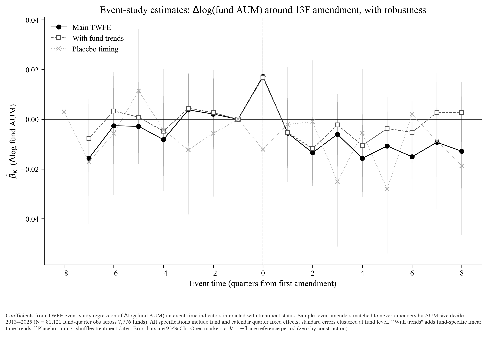

# Strategic Disclosure and Reported Fund Size: evidence from 13F amendments

A staggered difference-in-differences study of whether a fund's first 13F amendment coincides with a jump in its reported assets under management.

Data: QuantKiosk manager-level 13F value totals through its API (key needed; the raw file is not included). Paper: [souparneyac.github.io/research/strategic-disclosure](https://souparneyac.github.io/research/strategic-disclosure/).

## Overview

When a fund files a 13F-HR/A it corrects or adds to holdings it reported before. The question is whether amending funds look different in reported size around that event, which would point to strategic timing of disclosure and not clerical fixes.

- 81,121 fund-quarters, 2013 Q2 to 2025 Q1
- 4,254 amending funds and 3,522 matched never-amending funds
- An event study over eight quarters either side of the first amendment
- Four checks: fund-specific trends, a joint pre-trend test, placebo timing and a Goodman-Bacon decomposition

Treated funds are matched to never-amending funds by size decile, with a random draw (seed 537). The outcome is the quarterly log change in reported AUM, winsorized at the 1st and 99th percentiles.

## Results

| | Estimate |
|---|---|
| Amendment quarter (k = 0), main specification | +0.0172 log points (SE 0.0078, p about 0.027) |
| Same, with fund-specific linear trends | +0.0168 |
| Joint test that the pre-period coefficients are zero | F = 1.35, p = 0.23 |
| Placebo timing, k = 0 | -0.0121 (SE 0.0125) |
| Average post-amendment effect, simple difference-in-differences | -0.0013 (SE 0.0033, p = 0.68) |
| Weight on comparisons that use already-treated funds as controls | 29.1% in the paper; 29.0% on rerun |

The spike is 1.7 percentage points of reported AUM growth in the amendment quarter. The paper reads that as 59% of the treated group's mean pre-period growth. It does not last: the average post-amendment effect is indistinguishable from zero.



## Limits

- The outcome mixes investment returns, net capital flows and the reporting effect being tested, and 13F data cannot separate them.
- 29.1% of the identifying weight comes from comparisons that treat already-amended funds as controls. That can bias a two-way fixed-effects estimate when effects are transient. The estimator of Callaway and Sant'Anna (2021) is the standard fix and has not been run.
- Individual coefficients are noisy. At k = -7 and at k = 2, 4 and 6 the 95% interval excludes zero, even though the joint pre-trend test does not reject.
- A jump in reported size fits strategic disclosure. It does not rule out amendments that are clerical.

## Usage

```bash
pip install -r requirements.txt
python amendment_regression.py path/to/manager_value_totals.csv --out output
```

The input is the QuantKiosk file of quarterly value totals by manager (columns include `cik`, `form`, `period`, `valueTotal` and `reportingError`). The script builds the panel, runs the event study and the four checks, and writes the tables and the combined figure to `output/`.

The committed results in `results/` are the ones behind the paper. A rerun on the author's copy of the data reproduces the regression tables to within 1e-6. Its Bacon step was rewritten for this repository: the saved script had two bugs, so the corrected computation was reconstructed from the committed pair-level table. It reproduces the pair counts and the weights to within 0.0001 and gives 29.0% where the paper reports 29.1%.

## Project Structure

```
├── amendment_regression.py   # panel, event study, robustness checks, decomposition
├── requirements.txt
├── results/                  # coefficient tables, tests, decomposition, sample counts
└── figures/                  # raw means, options-share check, combined event study
```

## Notes

- `results/regression_notes.txt` is the log of the original run, including the note about the decomposition fix.
- The insider-buying-cluster design that the project started from is not part of this study.
- This is not affiliated with QuantKiosk.
