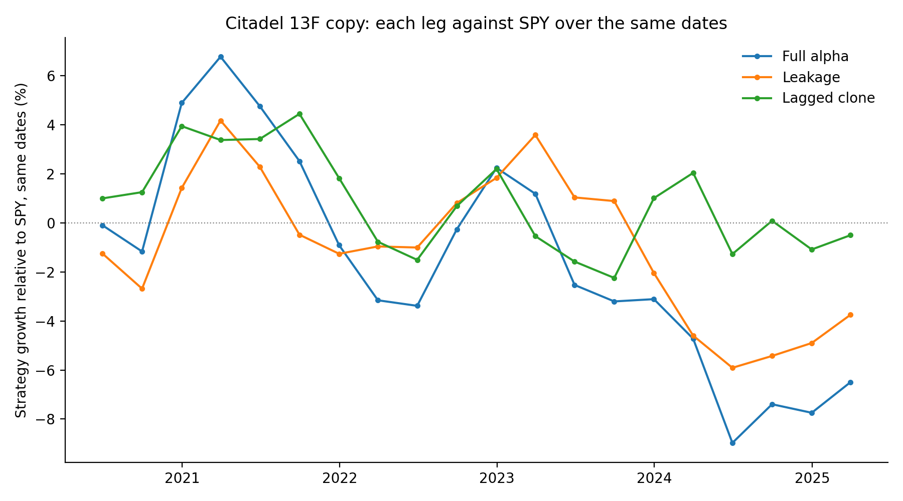
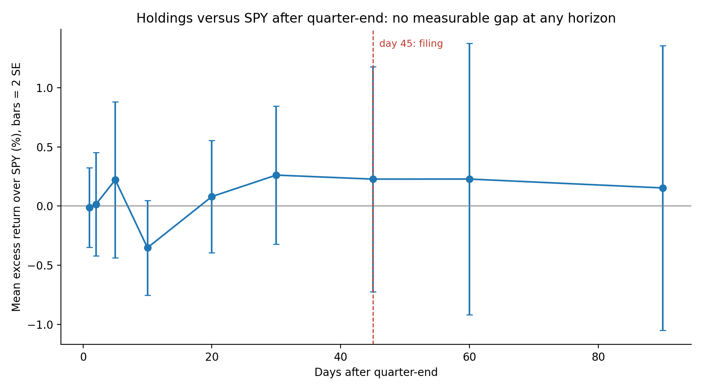

# Copying Citadel's 13F: a lagged-clone backtest

Can an investor make money by buying what Citadel Advisors reports in its 13F, on the day the filing is due? A 20-quarter backtest, and a check of the first version's conclusions.

Data: Citadel Advisors LLC 13F holdings through the QuantKiosk API (key needed; not included), Yahoo Finance adjusted closes, and the Fama-French factors from the Ken French Data Library.

## Overview

A 13F shows long equity positions as of quarter-end and is filed up to 45 days later, so a copier can only trade after the filing. The backtest splits each quarter into three legs, using the largest long equity positions per sector (about 220 to 270 positions a quarter):

| Leg | Holds from | To | Meaning |
|---|---|---|---|
| Full alpha | quarter-end | next quarter-end | what owning the book with no delay would have earned |
| Leakage | quarter-end | filing day (day 45) | the part of that return a copier misses |
| Lagged clone | filing day | next quarter-end | what a copier can actually earn |

- 21 quarters of filings, 2020 Q1 to 2025 Q1, which gives 20 quarters of returns
- 5,036 position-quarters in the backtest
- An information-decay curve: the average return of the holdings against SPY, day by day after quarter-end
- A four-factor regression (market, size, value, momentum)

## Results

The first version of this study reported a large theoretical edge that decays to nothing: full alpha 16.9% a year against SPY at 0.9%, "alpha gone by Day 2", and a significant four-factor alpha (p = 0.0011). Rechecking against SPY over the same dates, and with the factors lined up to the returns, does not support that. The clone result stands: it does not beat SPY. There was also no edge to lose before filing day in this sample.

**1. The benchmark covered half the days.** SPY in the first report was measured only from filing day to the next quarter-end, 926 of the 1,826 days in the sample, while the full-alpha leg is invested for all 1,826. Both were annualised over five years. Against SPY over the same dates:

| Leg | Strategy growth | SPY, same dates | Mean gap per quarter | p |
|---|---|---|---|---|
| Full alpha | 2.183 | 2.334 | -0.32 points | 0.61 |
| Leakage (quarter-end to day 45) | 2.124 | 2.206 | -0.17 points | 0.72 |
| Lagged clone (day 45 to quarter-end) | 1.040 | 1.046 | -0.02 points | 0.96 |

The full-alpha leg grew less than SPY, 16.9% a year against 18.5%. A market model on matching dates gives alpha of -0.3, -0.3 and -0.01 points a quarter (p between 0.57 and 0.98) with betas near 1.0.



**2. The factor rows were one quarter behind the returns.** In the saved regression table, the row dated 2020-03-31 holds the market factor for the quarter that ends on that date (-20.5%), while the return on that row is for the quarter that starts there (SPY +20.2%). The correlation between the saved market factor and SPY in the same row is 0.03; against the next row it is 0.99. That is why the saved market beta was -0.09 for a long-only equity book. With the factors paired to the quarter the returns cover (19 quarters; the last quarter's factors are not in the table):

| Series | Saved: alpha per quarter | p | Aligned: alpha per quarter | p |
|---|---|---|---|---|
| Full alpha, net of risk-free | +4.06% | 0.059 | -0.40% | 0.42 |
| Gap (full minus clone) | +4.38% | 0.0011 | +2.35% | 0.15 |

The aligned full-alpha series has a market beta of 0.96 and R-squared 0.97: it is the market. The significant size and momentum loadings on the gap series (p = 0.0006 and 0.0029) disappear too. The aligned clone regression shows an alpha of -2.8% a quarter (p = 0.04), but that compares a leg held for about half of each quarter with full-quarter factors; on matching dates its alpha is -0.01 points.

**3. The decay curve is flat, not decaying.** Average excess return of the holdings over SPY stays within about 0.35 points at days 1, 2, 5, 10, 20, 30, 45, 60 and 90. No day is significant across the quarters (smallest p = 0.09, at day 10). "Gone by day 2" implied something was there to lose; there is no measurable gap before filing day either.



**What the data can and cannot say.** Twenty quarters is little. For the clone leg the 95% interval on the mean quarterly gap to SPY is about plus or minus 0.9 points, so a real edge of a few percent a year could hide in it. The result is "no detectable edge in this sample", not "no edge".

### Other findings

- **Tenure segments.** The saved segment table splits positions by how many quarters Citadel has held them. The clone's growth over the sample rises with tenure, from 0.835 (1 to 3 quarters) to 0.921, 0.944 and 0.981 (20 or more), against 1.046 for SPY. All four trail SPY; the ordering is untested and the code that built the segments was not saved.
- **Filing lag.** Citadel's original filings arrive 45 to 47 days after quarter-end (19 of 21 quarters). Two quarters are amendments carrying the amendment's date, at 51 and 162 days, which is what makes the average lag in the holdings table look like 51. `results/filing_lag_by_firm.csv` has the same split for six other large filers.

## Limits

- **The backtest code was not saved.** The scripts that built the position returns, tenure segments, decay curves and factor table were lost; only their saved output objects remain. This repository recomputes everything from the quarter-level tables, so the position-level steps are not reproducible here. On the author's copy of the saved objects, the following were checked: each position return equals the price ratio it claims, and the quarter returns equal the weighted sums of the position returns. Not checked: the top-25-per-sector selection rule, the price cleaning, the decay-curve universe (about 95 positions a quarter, not the 5,036) and the segment construction.
- **The portfolio is not the whole book and is not fully invested.** Position weights are Citadel's own, not rescaled, and they sum to 83% to 99% of the sampled book. The remainder earns zero in the backtest, a small cash drag next to a fully invested SPY. The 13F shows long equity only, not shorts, derivatives or Citadel's market-making.
- **Execution is idealised.** The clone buys at the adjusted close on day 45, with no trading costs, even though Citadel typically files on day 45 to 47.
- **One fund, 20 quarters, one market regime.**
- **The factor table runs to 2024 Q4.** The last return quarter has no factor row, which is why the aligned regressions use 19 quarters.

## Usage

```bash
pip install -r requirements.txt
python analysis.py
```

`analysis.py` reads the committed tables in `results/`, prints the comparisons above and writes the recomputed tables and the two figures. No key and no data download is needed.

The upstream steps need the vendor data:

1. `01_fetch_holdings.R` pulls 21 quarters of Citadel's institutional holdings from the QuantKiosk API (set `QK_API_KEY`) and caches them.
2. `export_results.R <data_dir> results` turns the saved result objects into the quarter-level CSVs. The objects themselves (`backtest_results.rds` and four others) are not in this repository.

## Project Structure

```
├── 01_fetch_holdings.R      # 21 quarters of Citadel holdings via the API
├── export_results.R         # saved R objects to the quarter-level tables
├── analysis.py              # same-date comparison, regressions, decay tests, figures
├── requirements.txt
├── results/                 # quarterly returns, regressions (saved and recomputed), decay, lag
└── figures/                 # same-date comparison, decay curve with error bars
```

## Notes

- `results/quarterly_returns.csv` holds derived quarter-level returns and the quarterly Fama-French factors; no position-level or vendor holdings data is stored here.
- `results/factor_regressions_saved.csv` is the original, misaligned regression output, kept so the correction can be checked.
- This is not affiliated with QuantKiosk or Citadel, and is not investment advice.
