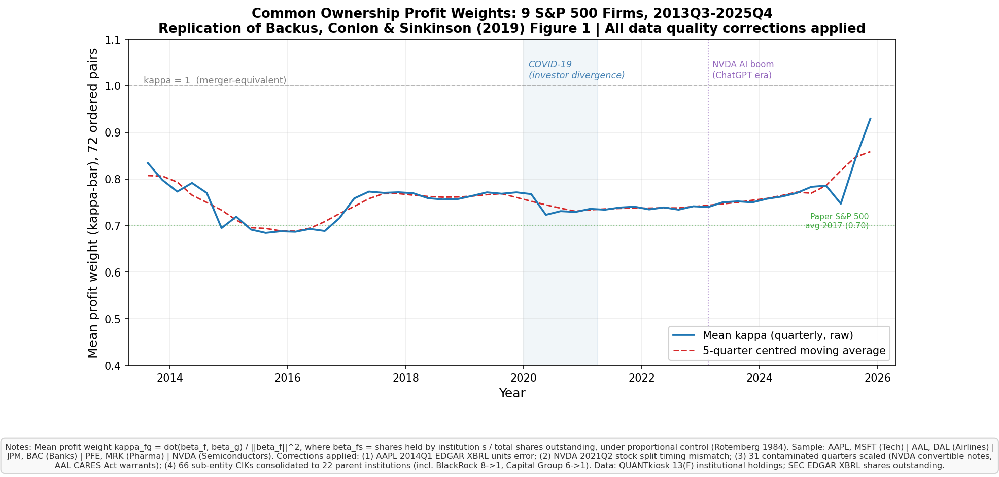

# Common Ownership in America: a replication on 13F data

Replicates and extends Backus, Conlon and Sinkinson (2019), "Common Ownership in America: 1980-2017", on 13F institutional holdings from 2013 Q3 to 2025 Q4. Most of the work was repairing the data.

Data: QuantKiosk 13F holdings through its API (key needed; raw holdings are not included). Share counts come from SEC XBRL filings.

## Overview

The paper measures how much competing S&P 500 firms share the same owners, and finds the overlap tripled between 1980 and 2017. This study extends the measure to 2025 on a 48-firm panel.

- 48 firms, 2,256 ordered pairs, 50 quarters: 112,800 kappa values
- Kappa split by investor group, with Vanguard, BlackRock and State Street shown separately
- A written record of the data faults found on the way, and how each was caught

Currently included:
- The pipeline that was run (`pipeline/`)
- The derived results, including the 112,800-row panel (`results/`)
- The scripts for the State Street audit and the entity-name matcher (`data_quality/`)
- Methodology, data guide, data-quality catalogue and entity-resolution notes (`docs/`)

## Results

Over the 48-firm panel (2013 Q3 to 2025 Q4):

| | |
|---|---|
| Mean kappa, 2013 Q3 | about 0.71 |
| Mean kappa, 2025 Q4 | about 0.92 |
| Full-sample mean | about 0.81 |
| Share of kappa from the Big Three | about 78% (Vanguard 35.7%, BlackRock 27.3%, State Street 14.9%) |

The 78% is a statement about the level of overlap in a large-cap sample. The paper's claim is about what drove the rise from 1980 to 2017. They answer different questions, so they do not conflict (`docs/methodology.md`).



## Data quality

The panel needed eight catalogued repairs plus one partial vendor gap. The faults were XBRL values reported 1,000 to 1,000,000 times too large, share counts restated after stock splits, convertible-bond holdings, a BlackRock amendment that doubled every position, and State Street holdings at about 72% of the expected level for two quarters.

- [docs/data-quality.md](docs/data-quality.md): each fault, how it was recognised and what was done
- [docs/entity-resolution.md](docs/entity-resolution.md): the fuzzy name matcher for securities whose CUSIPs were corrupted

The detection patterns are also in the tested package, `qk13f.quality` and `qk13f.resolve`, at the repository root.

## Limits

- Forty-eight large-cap firms is a convenience sample, not the S&P 500. Pairs are formed within it, so the level of kappa depends on which firms were pulled.
- The data repairs were applied by hand to the processed tables and are listed in `results/`. The steps cannot be replayed by running one script.
- One vendor gap is only partly recoverable: State Street holdings sat at about 72% of the expected level for two quarters, and the repair used EDGAR values where available and per-ticker interpolation elsewhere.
- The pipeline needs a QuantKiosk key and a day or more of API calls, so the headline panel cannot be rebuilt without access. The committed panel is the record of the run.

## Usage

The package and its tests need no data and no key:

```bash
pip install -e ".[dev]"
pytest
```

Re-running the pipeline needs a QuantKiosk key and a day or more of API calls. The steps are in order:

```bash
export QK_API_KEY=your_key_here
cd pipeline
python3 pull_data.py                 # holdings for each firm and quarter, with checkpoints
python3 compute_kappa.py             # kappa with the three corrections applied
python3 decompose_kappa_big3.py      # kappa by investor group
python3 make_plots.py
```

`docs/extending.md` explains how to add firms.

## Project Structure

```
├── pipeline/       # the scripts that produced the results
├── data_quality/   # State Street audit and the CUSIP name-matching tests
├── results/        # kappa panel, contamination scale factors, entity map
├── plots/          # figures
├── docs/           # methodology, data guide, data quality, entity resolution
└── Common_Ownership_Analysis_Report.pdf
```

## Notes

- The scripts in `data_quality/` and `pipeline/` are the record of what was run. Their paths assume the original working folder, so they are documentation, and the tested package is what to reuse.
- The corrections were applied to the processed tables by hand and are listed in `results/contaminated_quarters.csv` and `results/entity_consolidation_map.csv`.
- The original paper's own code and its pre-2013 scraped corpus are not redistributed here.
- This is not affiliated with QuantKiosk or the paper's authors.
