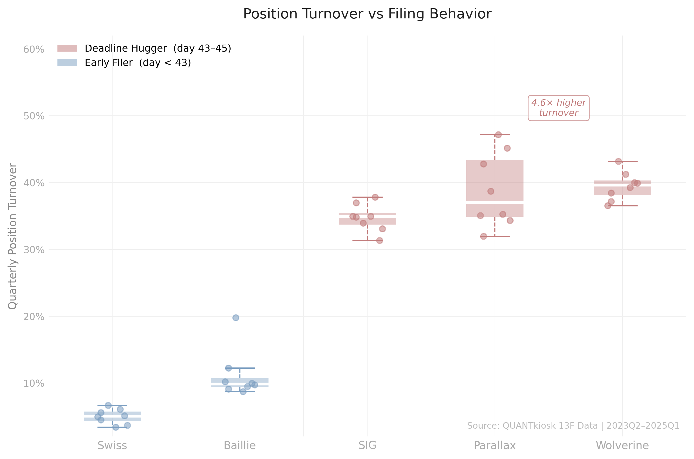

# Strategic Opacity: do funds that file at the deadline trade more?

A small comparison of five institutions' 13F filing lag against how much of their portfolio turns over each quarter.

Data: QuantKiosk 13F position-level holdings through its API (key needed; the raw filings file is not included).

## Overview

A fund has 45 days after quarter end to file its 13F. Some file on day 45 almost every quarter. The question is whether that habit goes with an unusually active portfolio, which is what you would expect if the delay is partly about keeping new positions out of view for a few more weeks.

- Filing lag for every 13F in the vendor data, 2013 to 2025, to find chronic deadline filers
- Three deadline filers and two early filers chosen from that list, then pulled at position level
- Eight quarters per fund, 2023 Q2 to 2025 Q1, which is 40 fund-quarters
- Position turnover, value turnover and options share for each fund-quarter

Turnover is `(new + deleted positions) / total positions`. Value turnover is the sum of absolute quarter-over-quarter value changes over total value. Options share is the fraction of positions that are calls or puts. A fund is a deadline filer if its filings arrive on day 43 or later, an early filer otherwise. The label is set per fund, not per quarter.

## Results

| | Deadline filers (3 funds, 24 fund-quarters) | Early filers (2 funds, 16 fund-quarters) |
|---|---|---|
| Average filing lag | 45.0 days | 35.7 days |
| Position turnover | 37.7% | 8.1% |
| Value turnover | 40.2% | 16.8% |
| Options share of positions | 61.1% | 0.0% |

Position turnover is 4.66 times higher for the deadline filers. The figure annotation says "4.6x"; that is the same number truncated.



Across the whole vendor sample (249,887 filings from about 11,800 institutions, lag between 0 and 50 days), 43.6% of filings arrive on day 43 or later, and the correlation between filing lag and options share is r = 0.12. That is positive but weak.

## Limits

This is a five-fund illustration, not a test. Read the 4.66 as a description of these funds.

- **The groups differ in kind, not just in filing habit.** The three deadline filers are Susquehanna, Parallax Volatility Advisers and Wolverine Trading, which are options market makers and volatility traders. The two early filers are Baillie Gifford and the Swiss National Bank, which are long-only. A market maker's book turns over because of what it does, whenever it files.
- **Options inflate the turnover measure.** Options positions open and expire every quarter, so counting positions mechanically raises turnover for any fund that holds many of them. The early filers hold none (options share 0.0%). The comparison cannot separate filing behavior from options use.
- **The funds are not comparable in size.** Average reported position value ranges from about $47 billion (Parallax) to about $554 billion (Susquehanna) across the five.
- **The labels are loose.** Three of the 40 fund-quarters sit on the other side of the 43-day line from their group: SIG at 42 and 37 days, Baillie at 44. One Wolverine filing arrived at 54 days, past the 45-day deadline.
- **Eight quarters per fund and five funds** leave no room for a significance test, and no claim about causes.
- **No volatility link is shown.** The study stops at turnover. It does not show that the delay hides anything or that the delay moves prices.
- **Options share and lag barely move together in the broad sample** (r = 0.12), and one fund, Simplex Trading, holds many options and files early, which the scripts flag and do not explain.

## Usage

```r
install.packages(c("dplyr", "ggplot2", "scales", "ggrepel"))
remotes::install_github("quantkiosk/qkiosk-r")
Sys.setenv(QK_API_KEY = "your key here")
```

Run the scripts in order from this folder:

1. `01_load_and_build.R` downloads the manager-level filing data, computes filing lag, keeps lags from 0 to 50 days, and picks the chronic deadline filers and early filers. It writes `clean.csv` (about 48 MB, not committed).
2. `02_analysis.R` pulls the five funds at position level for eight quarters, computes the turnover table and writes `turnover.csv`.
3. `03_visualizations.R` reads both CSVs and writes the four figures.

`turnover.csv` and `results/` are committed, so the results above can be checked without a key. Figures 1 to 3 are drawn from `turnover.csv` and Figure 4 from `clean.csv`. The script reads both files at the top, so it needs `clean.csv` to run at all.

## Project Structure

```
├── 01_load_and_build.R    # filing lag, filtering, fund selection
├── 02_analysis.R          # position-level pull, turnover table
├── 03_visualizations.R    # the four figures
├── turnover.csv           # fund-quarter table, 40 rows (output of step 2)
├── results/               # group and fund summaries, sample-wide statistics
└── figures/               # four PNGs
```

## Notes

- `clean.csv` is vendor data and stays out of this repository.
- Fund identifiers are fixed in `02_analysis.R` so the run needs no interactive search.
- `results/universe_stats.csv` holds numbers recomputed from the author's copy of `clean.csv`.
- This is not affiliated with QuantKiosk.
